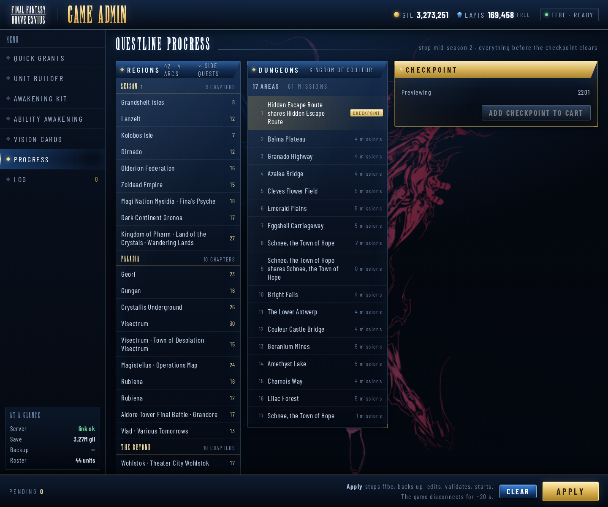
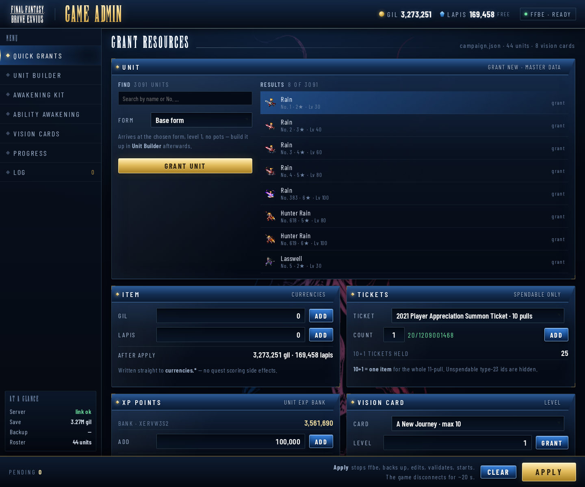
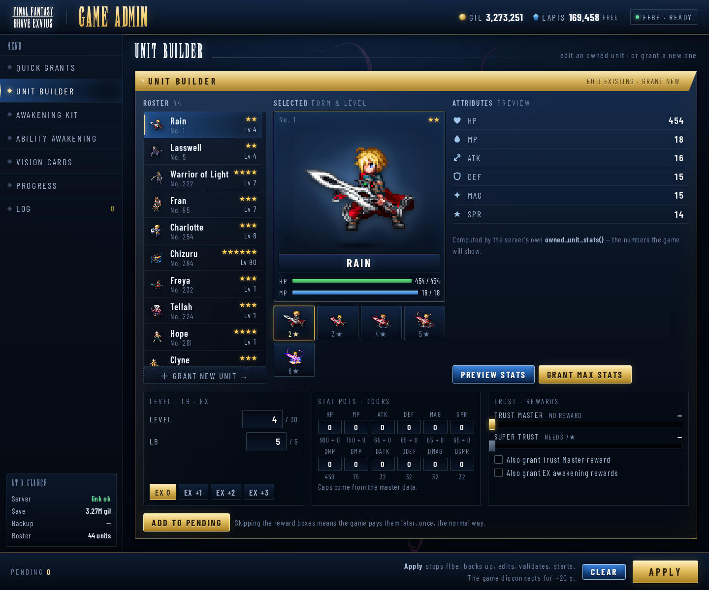

# FFBE Game Admin
*Note: built in the Pi coding harness with my own ARCANIST setup, plus some initial planning
assistance from Claude Code. If that puts you off, thanks for stopping by.*

A web page that edits your own Exvius Revival save. It grants gil, Lapis, tickets, materials
and vision cards, builds and awakens units, and replays story checkpoints and side content.
Every change is previewed before it is written.

It runs on the machine that runs the game container. It finds the save, the backups and the
data directory through `docker inspect`, so there is nothing to configure in the normal case.
Python and Docker are the only requirements.



| | |
|---|---|
|  |  |

## Quick start

```bash
git clone https://github.com/plasmatixultra/brave-exvius-game-admin
cd brave-exvius-game-admin
python3 app.py
```

Open `http://127.0.0.1:8750`. Python 3.12 or newer is required. There is no build step and no
package to install.

On the first request the app copies the engine's source out of the image into
`~/.cache/ffbe-admin/engine`, which is about 80 MB and takes under a second. Previews use that
copy.

The app looks for a container called `ffbe`. If yours has another name, or the app cannot
reach Docker at all, it says so on the page and refuses to apply anything. Copy
`admin.toml.example` to `admin.toml` and set the container name, or the two host paths when
Docker cannot be asked.

## If the game runs on another machine

The app uses the Docker daemon on its own machine and mounts that machine's directories, so
install it where the game runs.

```bash
# on the machine with the game
ADMIN_BIND=192.168.1.20 python3 app.py

# from your laptop
http://192.168.1.20:8750
```

The page has no password. Bind it to an address that only your own devices can reach, such as
a VPN or tailnet address. `0.0.0.0` on shared wifi lets anyone on that network edit your save.
When the bind address is not loopback, the page shows a warning.

If you would rather not expose it, forward the port over ssh:

```bash
ssh -L 8750:127.0.0.1:8750 you@the-game-box
```

Running the app on your laptop while the game runs elsewhere does not work yet. Two of the
containers it starts mount directories from the machine that runs Docker, so that machine has
to be the local one.

## The views

| View | What it changes |
|---|---|
| Quick Grants | Gil, Lapis, unit EXP points, grant tickets if you like the gacha, vision cards, and the units you want directly if you don't like pulls |
| Unit Builder | Level, awakening stars, LB level, EX level, pots, doors, trust and super-trust. Takes a unit as far as it goes |
| Awakening Kit | Awaken your units to any level you want all at once |
| Ability Awakening | An ability to a target tier, including the lower tiers it needs |
| Vision Cards | Card level and total EXP |
| Progress | Story checkpoints (Lapis, gil, missions, quests, esper trials, roster rewards) and side content per world. Move your save to any point, then carry on from where the game left off or replay what you liked |
| Log | Every apply, in order, with what it changed |

The numbers in a preview come from the game's own code, so caps, ticket types and quest rules
are the game's rather than a copy kept here.

## How it touches your save

The game loads the player once at startup and writes it back from memory, so a save that is in
use cannot be edited in place. An apply does this:

1. stop the game container
2. copy the save to `server/state/backups/campaign-<UTC>-<pid>.json`
3. edit a copy of the save inside the game image, with the engine's own code
4. check the copy against the backup and the expected deltas
5. replace the live file with an `mv` inside the same directory
6. start the container and poll until it reports the new save

If a step fails after the stop, the backup is restored and the container is started again. If
the app dies in the middle, the next start finds a marker file and finishes the restore. A
rollback is reported as a failure, never as success.

The app never writes the save itself. Every file operation happens in a throwaway container
that mounts the game's directories. The game writes those files as root, so a host-side write
would need sudo on Linux and would behave differently on a NAS or Docker Desktop. The app
needs no sudo, no ssh and no root.

An apply takes about twenty seconds, and the game is down for that time.

## If something goes wrong

The page reports what it found before it offers any controls. These are the usual messages:

| The page says | What it means |
|---|---|
| container ffbe was not found | the game container is not running, or has another name. Set `container` in `admin.toml` |
| Set container, server_dir and data_dir | Docker could not be asked at all. Fill in the two host paths |
| this engine cannot run the agent: missing ... | the image is newer or older than the one this was built against. The message names the missing symbol, and the app stops before touching anything |
| this page is reachable from other machines | `ADMIN_BIND` is not loopback and there is no password |
| another apply is already running | one apply runs at a time. Wait for it to finish |

Each apply leaves a backup named `campaign-<UTC>-<pid>.json` in `server/state/backups/`. To
undo an apply by hand, stop the container and copy that file over `server/state/campaign.json`.
Root owns the file, so copy it as root or through a container.

## Requirements

- Python 3.12 or newer. The app uses the standard library only.
- Docker, with the game container running or present
- The `ffbe-ios-server:local` image from
  [Exvius-revival-ios](https://github.com/CreamySeaman6/Exvius-revival-ios)
- A user that can run `docker`, which usually means membership of the `docker` group

Known good: Linux, the image above, a real save, and test runs that included a killed apply, a
refused apply and a rollback. The app checks the image for the engine symbols it uses and
refuses to apply, before stopping anything, if one is missing.

Not tested: Windows, macOS, rootless Docker, and other engines. File operations run inside
containers and the lock works on both platforms, but test before you rely on it. Tell me how it goes
and I'll work on Windows and Android versions.

## What it does not do

- No accounts, no authentication and no password. It binds `127.0.0.1` unless you say
  otherwise, and it warns you when it is reachable from somewhere else.
- It does not change the game's code and does not bypass the engine.
- It does not add services to your Docker setup. No compose edits, no socket mounts.
- It does not run on your laptop while the game runs on another machine.

## Uninstall and rollback

- Stop it with Ctrl-C or by killing the `python3 app.py` process. Nothing else keeps running.
- Remove it by deleting the folder and `~/.cache/ffbe-admin`. The next install rebuilds the
  cache.
- Undo an apply with the backup, as described above.
- If port 8750 is taken, start it with `ADMIN_PORT=9000 python3 app.py`.

## Development

There are no dependencies and no build step:

```bash
python3 -m unittest tests.test_app tests.test_pipeline tests.test_parity tests.test_cache \
    tests.test_config tests.test_transport tests.test_applysave tests.test_engine \
    tests.test_compat tests.test_packaging
bash tests/test_apply_files_sh.sh
sh tests/run_in_container.sh                    # needs the game image
node tests/ui_check.mjs http://127.0.0.1:8750   # needs a running stack
```

Where things live:

- `app.py` serves the page and its JSON API.
- `applysave.py` runs the stop, backup, edit, swap and restart sequence.
- `transport.py` is the only module that calls `docker`.
- `config.py` works out where the game lives. `engine.py` exports the engine's source.
- `compat.py` checks the image for the symbols the agent imports.
- `localdata.py` caches the save and the data tables for reads.
- `agent/` holds the operations. `runner/apply-files.sh` is the worker that runs in the image.
- `static/` is the page. `data/` holds the area and region name tables, and
  `tools/gen_area_names.py` rebuilds them from the community dumps (`--write`).

## Links

- Game server: [CreamySeaman6/Exvius-revival-ios](https://github.com/CreamySeaman6/Exvius-revival-ios)
- Android side: [Elvlin/exvius-offline](https://github.com/Elvlin/exvius-offline)
- "Final Fantasy" font by Juan Pablo Reyes Altamirano: [Final Fantasy font](https://www.fontspace.com/final-fantasy-font-f8000)

## Disclaimer

Unofficial fan tool. It edits your own save file and is not affiliated with or endorsed by
Square Enix, Gumi or the Revival projects. The game, its data tables and its art belong to
their owners, and none of the game's binaries are in this repository. Keep the backups it
makes. Use at your own risk.

## Licence

MIT. See [LICENSE](LICENSE).
